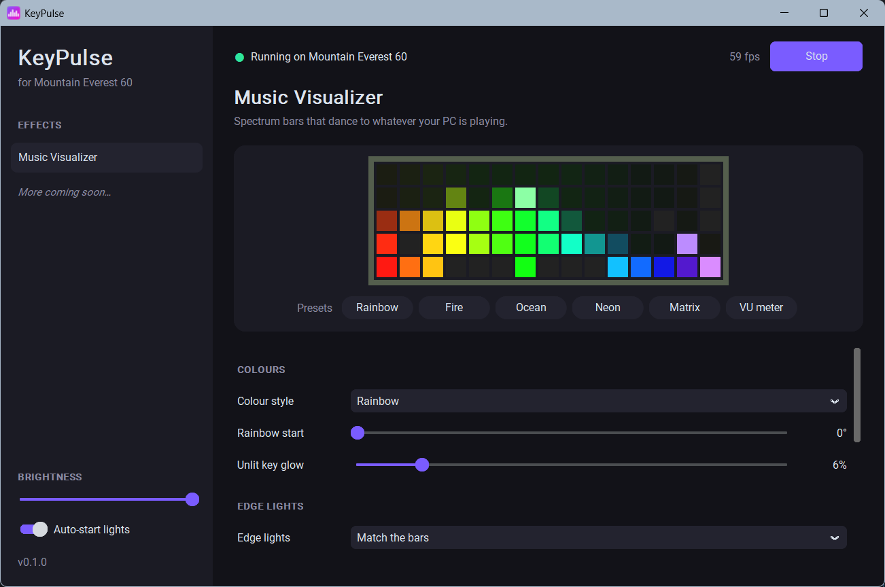

# KeyPulse

Lighting effects for the **Mountain Everest 60** keyboard on Windows, starting with a music visualiser that reacts to whatever your PC is playing.



## Features

- **Music Visualizer**: reacts to whatever your PC plays (YouTube, Spotify, games), following your output device
  - Four patterns: **Bars**, **Mirror** (bass in the middle), **Ripple** (beats send rings across the keys), **Flow** (scrolling waterfall)
  - Kicks pulse, big hits flash (scaled to how big the hit is), drops send a shockwave across the board, hi-hats sparkle
  - Colours: rainbow, one, two or three colours, plus 14 presets, and save your own (right-click a ★ preset to delete it)
  - Advanced settings for edge lights, flash and sparkle colours, sensitivity, fall speed and LED contrast
- **Type to Light**: spell a word on the keys (spell it out, typewriter, neon sign), or light the next letter each time you press a key
- Live preview of the keyboard in the app
- Settings are saved automatically
- No setup: OpenRGB is bundled and runs hidden in the background, only touching the Everest 60

## Install

1. Download `KeyPulse-x.y.z-win64.zip` from the [latest release](../../releases/latest).
2. Extract it anywhere, for example `Documents\KeyPulse`.
3. Run **`KeyPulse.exe`**.
   - Windows SmartScreen may say *"Windows protected your PC"* because the app isn't code-signed. Click **More info → Run anyway**.

### Before the first run

- **Update the keyboard's firmware once with Mountain Base Camp.** Older firmware (1.10) doesn't expose the lighting interface KeyPulse uses. Firmware 1.45 or newer works.
- **Close Base Camp** before using KeyPulse. Two programs can't control the lights at the same time.
  To stop Base Camp's background service from starting with Windows, run this once in an admin PowerShell:
  ```powershell
  Stop-Service BaseCampService; Set-Service BaseCampService -StartupType Manual
  ```
  (Base Camp still works when you open it, for example for future firmware updates.)

## Troubleshooting

| Problem | Fix |
|---|---|
| "can't see the Everest 60" | Plug the keyboard in directly, close Base Camp, and check the firmware was updated once. |
| Lights freeze but typing still works | Unplug the keyboard for 5 seconds and plug it back in. That resets its lighting controller. |
| Bars don't move | Check sound is playing through the default output device. KeyPulse follows the default device, including headphones. |
| Something else | Send the log: `%APPDATA%\KeyPulse\keypulse.log` |

## For developers

```powershell
pip install -r requirements.txt
powershell -ExecutionPolicy Bypass -File build.ps1   # fetches OpenRGB into vendor\ and builds dist\
python -m keypulse                                   # run from source (uses vendor\OpenRGB or an installed OpenRGB)
```

Project layout:

```
keypulse/
  audio/loopback.py     WASAPI loopback capture (ctypes, no extra dependencies)
  audio/features.py     per-band levels, kick + hi-hat onset detection
  openrgb/client.py     minimal OpenRGB SDK client
  openrgb/runtime.py    starts the bundled OpenRGB hidden, keyboard-only
  effects/base.py       Effect base class, settings schema, keyboard layout
  effects/visualizer.py the music visualiser
  engine.py             background render loop (60 fps)
  ui/app.py             the window
tools/tuning_test.py    offline benchmark for the audio analysis
```

### Adding an effect

Subclass `Effect` in `keypulse/effects/`, list its settings as `Control(...)` entries (the settings panel is generated from them), implement `render()` to return one `(r, g, b)` per LED, and register it in `keypulse/effects/__init__.py`.

## Licence

KeyPulse is MIT licensed. The Windows download bundles OpenRGB (GPL-2.0). See [THIRD_PARTY_NOTICES.md](THIRD_PARTY_NOTICES.md).
